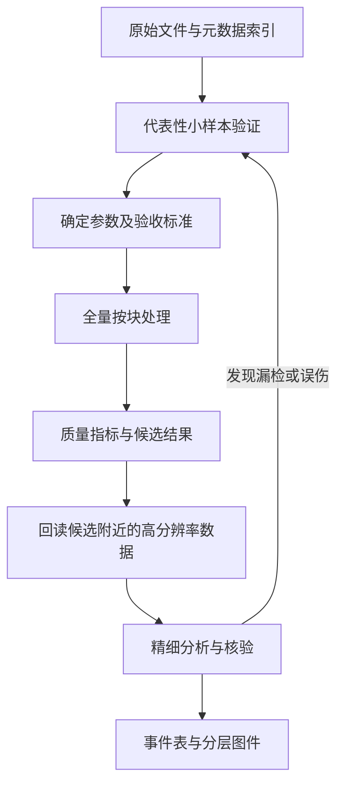

# 大型 DAS 数据：先小样本验证，再分块扩展

本指南是处理设计建议，不是已在某台电脑上测得的性能保证，也不把固定块时长当作通用标准。

## 一、先建立索引

不要为了查看文件范围就把整段波形 `.load()`。优先记录：文件路径、时间范围、通道范围、采样率、数据类型、单位、计时方式、几何来源、缺口和重复记录。虚拟数据集主要组织已有文件，不等于复制一份全部波形；移动源文件可能导致虚拟引用失效。

## 二、用代表性样本确定方法

同时抽取目标事件、安静背景、强噪声和异常片段。检查目标频段、有效通道、模型输入和阈值，并预先定义如何判断误检、漏检或信号损伤。不要只用最清晰事件选参数，再宣称全量有效。

## 三、估算内存，再实测块大小

数组数值区的字节数约为：块时长 × 每秒采样数 × 通道数 × 单值字节数。

例如 10,000 通道、1,000 Hz、float32：每秒约 40 MB，每分钟约 2.4 GB，每小时约 144 GB（十进制单位）。这不是磁盘压缩大小，也不包含中间副本和模型张量。实际峰值内存需要测量，不能只让输入数组勉强装得下。

先选择保守块大小，再记录读取时间、处理时间、写入时间、峰值内存及显存。检查瓶颈后再调整；不要一开始就开满并行。

## 四、正确处理块边界

| 操作 | 需要跨块保留或补充什么 | 不能怎么做 |
| --- | --- | --- |
| 因果 IIR 滤波 | 滤波状态 | 每块从零开始却声称整段等价 |
| 滑窗统计、STFT、模型推断 | 足够的窗口上下文或缓冲 | 将边缘预测直接当成内部预测 |
| 零相位双向滤波 | 前后数据及足够边界范围 | 当作无延迟实时因果操作 |
| 重采样 | 滤波记忆及采样网格对齐 | 每块独立取点导致时间轴漂移 |
| 事件关联 | 跨窗口候选、缓冲及去重 | 在文件边界截断同一事件 |

对于连续块传递状态；遇到真实缺口，按算法规则结束旧段或重置。不是所有操作都靠同一种重叠方式解决。Xdas Atom 提供状态管理框架，但用户自定义步骤仍需验证。

**最低验证要求：**取一段能放进内存的数据，用新建或正确重置的流程分别整段处理、分块处理。改变块大小和切分点，比较坐标、波形差异及拾取；浮点结果可设合理容差，不能只比较输出长度。

## 五、粗筛与精查分开

粗筛节省计算，但过强抽稀可能漏掉局部事件。因此抽查被筛掉的区段，评估粗筛损失；不能只检查留下来的事件。

## 六、边处理边保存，支持恢复

优先保存质量指标、拾取和事件表、必要波形片段，以及输入清单、参数和软件版本。不要把所有处理块放进一个列表后最后再拼接。Notebook 的输出显示和巨幅绘图也可能占用大量内存。

完成一个输出后再标记该块成功；写入中断不能算完成。可先写临时产物，完整关闭后再发布最终名称；读取端要遵守同一发布协议。断点恢复不仅要知道文件编号，还应恢复状态，或从更早的上下文重新计算并去重。

## 七、并行与实时的附加条件

- 独立记录或无状态任务可以并行；有时间依赖的连续块不能任意打乱。每个进程都有自己的内存开销。
- 实时系统应同时监测数据时间、队列长度、端到端延迟、缺包和写入失败。平均速度够快不代表峰值期间不会积压。
- 明确无数据等待、结束信号、超时和安全停止策略。`until` 是数据时间终点，不是计时器。

依据：[Xdas 处理单元](https://xdas.readthedocs.io/en/latest/user-guide/pipeline/atoms.html)、[处理超出内存的数据](https://xdas.readthedocs.io/en/latest/user-guide/pipeline/processing.html)。官方路径或 API 若变化，回到 [Xdas 文档首页](https://xdas.readthedocs.io/) 查阅对应版本。
