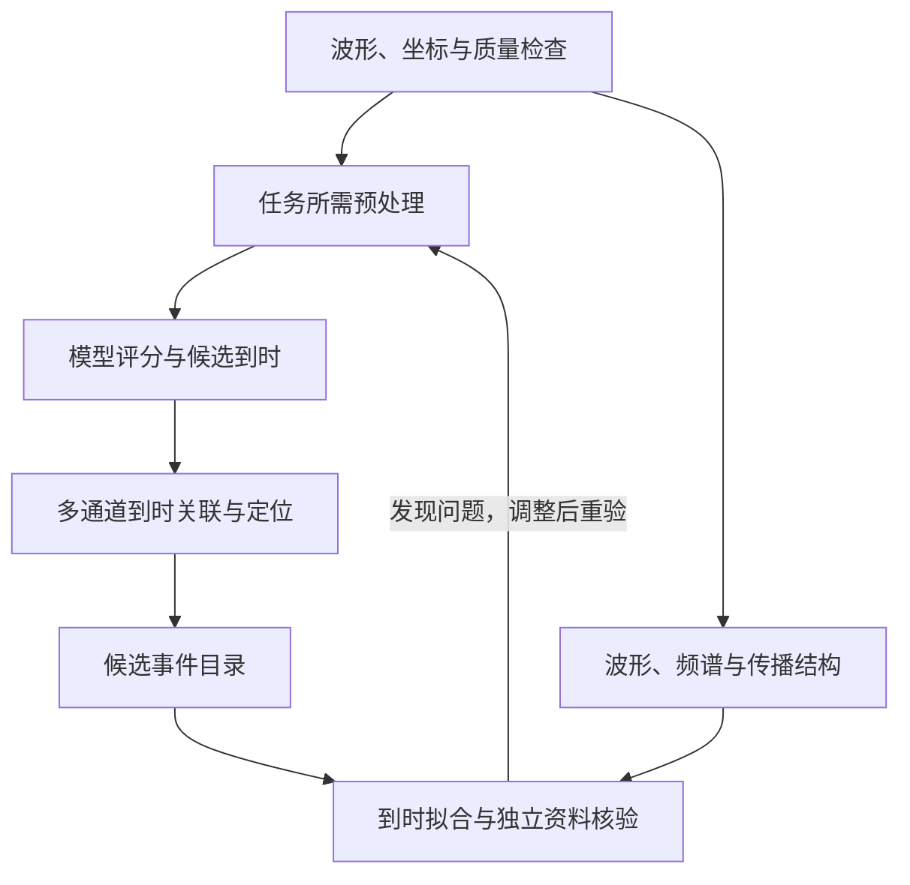

# 从原始 DAS 数据到事件结果：总导读

核心不是固定的“降采样—滤波—模型—画图”，而是根据问题设计处理链，用证据检查结果，再扩展到大数据。

## 1. 先确定问题

地震、车辆、环境噪声、地下结构研究需要的信息并不相同。对地震检测无用的背景，可能正是环境噪声分析的对象。处理参数应由目标、仪器、实际数据与验证结果共同决定。

## 2. 地震教程的分析关系

这是分析关系图，不是每个 Notebook 的逐行调用图。绘图检查贯穿全程；用于显示的高通加绝对值流程，不应自动接到模型前面。

## 3. 每一步都问四个问题

| 环节 | 输入是什么 | 为什么做 | 主要风险 | 检查方式 |
| --- | --- | --- | --- | --- |
| 时空选取 | 原始记录与坐标 | 聚焦任务范围 | 只选漂亮事件造成偏差 | 同时覆盖安静、强噪声和边界样本 |
| 重采样 | 有采样信息的波形 | 适配尺度、模型或计算预算 | 混叠及局部信息损失 | 检查频带、波形和坐标 |
| 滤波 | 波形及目标频带 | 抑制不需要的频率成分 | 真实信号被削弱、相位改变 | 同色标对比、频谱与到时检查 |
| 模型推断 | 满足模型要求的输入 | 提取候选 P/S 到时 | 域差异、误检、漏检 | 概率、原波形及跨通道传播对照 |
| 关联定位 | 到时、位置与速度模型 | 寻找共同事件解释 | 坐标、时间和速度模型偏差 | 拟合残差、独立台站或目录对照 |
| 可视化 | 明确来源的结果 | 观察结构、发现异常 | 色标和聚合方式误导 | 标明物理量、单位、处理与抽稀方式 |

## 4. 模型输出不是直接的“事件分类”

PhaseNet 的评分不等于已确认地震；阈值提取的到时也不等于独立事件。GaMMA 将候选到时与位置、传播时间模型结合进行关联定位。若要识别“车辆、地震、施工”等类别，需要另外定义分类任务、模型和评测数据，不能把本教程的 P/S 类别直接当作这些事件类别。

## 5. 处理顺序需要依据

例如，降采样需要抗混叠处理；取绝对值会改变符号和频谱；基于一段光纤平均得到的参考信号，可能同时包含真实相干波。不能把教程的每种探索操作串成一条默认生产流程。

详细阅读：[信号处理](../topics/signal-processing.md)、[检测与事件解释](../topics/detection.md)、[大型数据](large-data.md)、[可视化与验证](../topics/visualization.md)。

依据与进一步阅读：[上游教程](https://github.com/xdas-dev/tutorials)、[Xdas 处理单元说明](https://xdas.readthedocs.io/en/latest/user-guide/pipeline/atoms.html)。API 随版本变化，以本地版本和实际验证为准。
