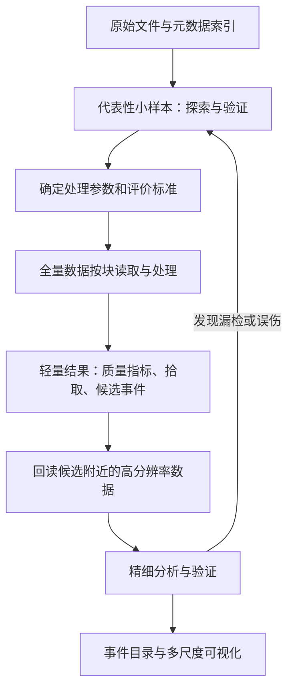

# **从 DAS 原始数据到事件结果：处理、检测与验证总导读**

学完七篇 Xdas 教程，很容易把过程概括成“选数据、降采样、滤波、模型检测、输出结果，最后画一张图”。这抓住了操作主线，但还需要补上两点：

- **先明确研究目标，再决定怎么处理。**不是所有 DAS 数据都需要同样的降采样和滤波。
- **模型输出不一定是“事件分类”。**在本系列的地震示例中，PhaseNet 产生 P、S 波相关评分，再提取候选到时；GaMMA 将多个拾取关联成事件，并估计位置和发震时刻。

所以，这套教程更完整的逻辑是：

> **明确问题 → 理解与检查数据 → 有目的地处理 → 提取证据 → 关联或解释事件 → 可视化与验证。**

这里的箭头表示分析逻辑，不是一条所有数据都要原样执行的固定代码链。可视化和验证也不是最后才做，而应贯穿整个过程。

## **一、把七篇教程放回这条主线**

| 环节 | 真正要回答的问题 | 教程中的对应内容 |
| --- | --- | --- |
| 数据组织 | 文件里是什么？哪些时间、通道可以用？ | 打开文件、合并记录、检查时间连续性 |
| 坐标与质量检查 | 这个通道在哪里？有没有缺测、异常或盘纤？ | 时间坐标、光纤几何、台站位置 |
| 数据处理 | 为了当前目标，要保留什么、抑制什么？ | 重采样、滤波、共模处理等 |
| 特征或模型推断 | 数据中有哪些值得关注的证据？ | 振幅、频谱、频率—波数分析、PhaseNet 拾取 |
| 事件解释 | 这些证据是否属于同一个事件？事件在哪里？ | GaMMA 到时关联与定位 |
| 验证与展示 | 结果可靠吗？处理有没有误伤信号？ | 波形对比、拾取叠加、理论到时拟合、定位图 |
| 规模化执行 | 数据放不进内存或不断到来，怎么办？ | 分块处理、流水线、模拟实时流 |

**就分块和流式执行这条主线而言，教程 3 和教程 7 的重点不是新增一种地震分析原理，而是让处理流程能够应用于更大、持续到来的数据。**它们也包含检测示例，但“如何检测”和“如何规模化执行检测”需要分开理解。

第一次复现仍建议按教程 1 至 7 顺序进行，避免缺少前篇产物；具体文件来源见[学习路线](learning-path.md)。

## **二、处理逻辑：不是“把数据弄干净”，而是为任务保留信息**

### **1. 选数据：先明确你究竟要找什么**

例如：

- 找地震：关注可能的地震波形、传播特征、P/S 到时。
- 找车辆：关注沿线路移动的轨迹及其速度。
- 分析环境噪声：可能恰恰要保留长时间的背景振动。

因此，**“噪声”并不等于振幅小或看起来杂乱，而是相对于研究目标而言不需要的成分。**

选择时间段和通道时，也不能只选“看起来最漂亮”的部分，否则容易高估方法效果。

### **2. 降采样：减少冗余，但必须知道会丢掉什么**

需要分清两个方向：

| 操作 | 减少什么 | 主要风险 |
| --- | --- | --- |
| 时间降采样 | 每秒的采样点数 | 高频信息丢失或混叠 |
| 空间降采样 | 沿光纤保留的通道数 | 短波长、局部事件和精细传播结构丢失，也可能产生空间混叠 |

时间降采样前，要通过适当的抗混叠滤波限制频带；空间降采样也要考虑空间混叠，不能认为“隔几个通道取一个”总是安全。

**用于粗筛的采样密度，和用于精细定位、波形研究的采样密度，可以不同。**但粗筛本身也需要检查是否漏掉了目标事件。

### **3. 滤波：依据目标信号的频带，而不是依据图好不好看**

选择频带的依据应包括：

- 目标现象可能出现的频率范围；
- 实际数据的频谱及背景噪声；
- 仪器响应与采样率；
- 后续模型的输入要求。

例如，教程中的高通滤波能削弱缓慢变化，但**缓慢变化也可能包含真实信号；高频噪声仍可能通过。**

同样，取绝对值方便显示振幅强弱，却改变了信号的正负和频谱。**适合画图的处理结果，不一定适合直接交给模型。**

不要把教程中的所有探索操作都接到模型前面。实际模型输入应以相应代码和模型约定为准。进一步阅读[信号处理决策](../topics/signal-processing.md)。

## **三、检测逻辑：从“一个分数”到“一个事件”，还有距离**

结合本系列的地震示例，可以分成三个层次：

| 层次 | 输出是什么 | 不能直接说明什么 |
| --- | --- | --- |
| 模型预测 | 不同时间位置的 P/S 概率或评分 | 不等于已经确认有地震 |
| 阈值与峰值提取 | 某通道的 P/S 候选到时 | 不等于独立地震事件 |
| 多通道关联 | 一组可由同一事件解释的到时，及事件参数 | 不等于结果已经得到真实目录验证 |

PhaseNet 主要解决“**这里像不像 P/S 到时**”；GaMMA 进一步解决“**哪些到时可能来自同一个地震**”。

大型 DAS 的通道很多，因此不能只看单个通道的高分预测。还应检查：

- 相邻通道的到时是否形成合理的传播结构；
- 是否存在重复拾取或边界误检；
- 理论到时与实际拾取是否相符；
- 有无独立台站或事件目录可以核对。

模型阈值应在代表性样本上检验，不能把教程里的参数直接当作通用标准。跨通道一致性是证据，不是保证，因为相干噪声也可能共同触发多个通道。

如果研究目标是区分“地震、车辆、施工”等事件类型，还需要另外定义分类任务、标签和评价标准；本系列的 P/S 类别不能直接代替这些事件类别。进一步阅读[检测与事件解释](../topics/detection.md)。

## **四、大型 DAS：关键是“小样本定方法，分块跑全量”**

**不要先把所有数据读进内存，再开始探索。**可以采用下面这个结构：

这张图表示一种处理设计，不是某个 Xdas 函数的内部调用过程。先用小样本建立和验证方法，再做全量计算；发现问题后返回调整，而不是只积累更多输出。

### **1. 先建索引，不急着读波形**

记录每个文件的时间范围、采样率、通道范围、数据类型、物理量和单位，以及缺口、重复和异常情况。

这里要区分：

> **磁盘上有很多文件，不等于内存里必须同时装下这些文件。**

Xdas 的虚拟组织与分块执行，就是为此服务的。其 Atom 机制还能让有状态的操作在连续数据块之间传递状态。可以把它理解为：先知道数据在哪里，计算时再按需读取，而不是打开目录就一次读完所有数值。

### **2. 先用代表性小样本把方法跑明白**

样本至少覆盖：

- 清楚的目标事件；
- 安静背景；
- 强噪声；
- 缺测或异常通道。

在这些样本上确定频带、采样率、模型参数和作图方式。**只在一个清晰事件上有效，还不足以说明能处理整批数据。**

### **3. 根据内存预算确定块大小**

数组数值区的内存可以估算为：

$$
M \approx T \times f_s \times N_{\mathrm{channel}} \times b
$$

其中，$T$ 是块时长（秒），$f_s$ 是时间采样率（每秒采样数），$N_{\mathrm{channel}}$ 是通道数，$b$ 是每个数值的字节数；$M$ 因而以字节计。

例如，1 万通道、1000 Hz、`float32`（每个值 4 字节）：

- 每秒约 **40 MB**；
- 一分钟约 **2.4 GB**；
- 一小时约 **144 GB**。

这里使用十进制 MB、GB，估计的是未压缩数组数值区，不是磁盘压缩文件的大小。

这些还没有包含滤波中间数组、模型张量和绘图副本。块大小要实测峰值内存，不能按“刚好装下原数组”来选。

### **4. 分块不是把每块当成互不相关的数据**

这是最容易出现“代码跑通、结果却不对”的地方。

| 操作 | 块边界需要处理什么 |
| --- | --- |
| 因果 IIR 滤波 | 前一块留下的滤波状态 |
| 滑动平均、STFT | 跨边界窗口所需的数据 |
| 模型滑窗推断 | 足够上下文、边缘预测与重叠去重 |
| 时间降采样 | 滤波状态及采样位置对齐 |
| 事件关联 | 跨块到时及跨边界事件 |

**连续数据要接上状态；真实缺口不能假装连续。**具体如何重置或补齐，取决于算法和数据。

Xdas 提供了相关状态管理机制，但自己的处理流程仍应做分块一致性验证，而不是默认任意组合都会正确。

最直接的验证办法是：选一段能放进内存的数据，分别整段处理、分块处理，对比波形、坐标和检测结果。改变块大小和切分点，尤其检查事件是否恰好跨边界。比较时使用新建或正确重置的流程，避免把前次运行状态带入对照；浮点结果可根据任务设定合理容差。

### **5. 边处理边保存，不积攒全部结果**

优先保存：

- 每块的质量指标；
- 拾取表和候选事件表；
- 必要的事件片段；
- 参数、软件版本、输入文件和处理日志。

不要默认把每一步的完整数组都另存一份。原始数据保留，中间结果按复用价值选择保存；同时记录已经处理到哪里，便于中断后恢复。

断点恢复也不只是从下一个文件名开始：有状态的计算需要恢复状态，或回读足够上下文重新计算，再处理重复输出。更多实现注意点见[大型 DAS 数据指南](large-data.md)。

### **6. 并行要服从数据依赖**

独立记录、不同且互不依赖的任务可以并行；但有时间状态的连续块，不能随意打乱后各自处理。

并行数量也不是越多越好：可能先耗尽内存、磁盘带宽或显存。先测单块速度和资源占用，再逐步增加。

## **五、可视化逻辑：不是最后“补一张图”，而是贯穿验证**

大型 DAS 不适合把全部采样点画进一张图。应当分层看：

| 尺度 | 适合看什么 | 图的作用 |
| --- | --- | --- |
| 全天或整段观测 | 分时段 RMS、频带能量、有效通道比例 | 找候选时段和质量异常 |
| 事件附近 | 时间—距离图及拾取叠加 | 看传播结构、漏检和误检 |
| 局部细节 | 单通道波形、频谱、处理前后对比 | 检查处理是否保留目标信息 |
| 事件解释 | 到时拟合、残差、定位图 | 检查事件关联及定位是否合理 |

特别注意：概览图对数据做平均可能让短促事件消失；峰值、RMS、均值各有用途，不能互换。比较滤波前后时，应统一色标、时间范围、通道范围和单位；如果另做归一化，也要明确说明。

每张图都应交代输入数据、处理步骤、轴与颜色含义。模型评分图、处理后的振幅图和原始波形图，分别展示不同的信息，不能只凭“颜色更集中”就判断模型更准确。

进一步阅读[可视化与验证](../topics/visualization.md)。

**最终，学到的不是一套固定的“降采样—滤波—模型—画图”配方，而是：根据问题设计处理链，用证据验证结果，再让这条处理链安全地扩展到大数据。**

## **依据与继续阅读**

- [Xdas 上游教程](https://github.com/xdas-dev/tutorials)：本系列的代码与案例来源。
- [Xdas 入门](https://xdas.readthedocs.io/en/latest/getting-started.html)：数据组织与处理单元。
- [处理单元与流程组合](https://xdas.readthedocs.io/en/latest/user-guide/pipeline/atoms.html)：状态及流程概念。
- [处理超出内存的数据](https://xdas.readthedocs.io/en/latest/user-guide/pipeline/processing.html)：分块执行与输入输出。
- [SciPy 抗混叠降采样](https://docs.scipy.org/doc/scipy/reference/generated/scipy.signal.decimate.html)：降采样前的频带限制。

本导读将教程内容整理为学习与处理设计框架，不代表所有步骤都在每篇教程里完整执行，也不保证同一参数适用于所有场景。具体 API 以实际环境版本为准，自己的流程仍需验证。

[回到首页](../README.md) · [教程索引](../tutorials/xdas/README.md)
